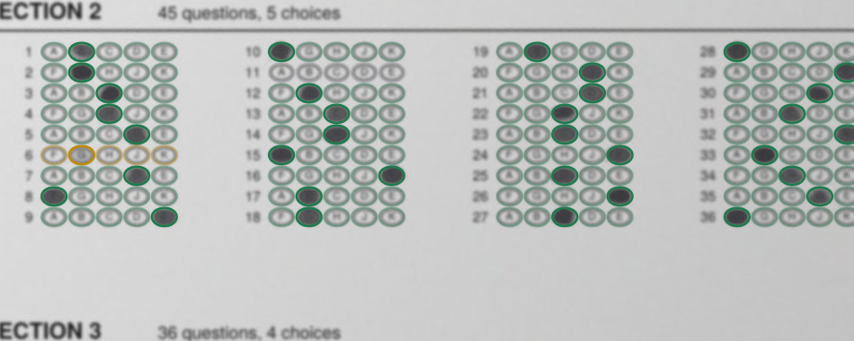

# Bubble sheet recognizer

Reads a phone photograph of a filled multiple-choice answer sheet and returns, for every
question, which oval was marked and how sure it is. It runs entirely in the browser — one
JavaScript file and OpenCV.js, no server, no upload, no model weights.



Green rings are answers read cleanly, amber is a mark the engine wants a human to confirm,
red is two marks on one question. The rings are drawn where the engine *sampled*, not where
it guessed, so a misalignment is visible at a glance rather than hidden inside a number.

This is the recognition half of a production system: students at a test-prep site fill
paper answer sheets, photograph them on whatever phone they own, correct anything the
scanner flags, and submit. The host application is private; the recognizer, the sheet
toolchain and the evaluation harness are here, with an original demo sheet in place of the
published answer document it was built for.

## Quick start

```
pip install reportlab pdfplumber pillow numpy opencv-python-headless playwright
playwright install chromium          # poppler-utils (pdftoppm) must also be on PATH

python3 eval/gen_synth.py            # synthesise 14 photographs + ground truth
python3 eval/run_test.py             # run the engine over them and score it
python3 -m http.server 8000          # then open http://localhost:8000/demo/
```

The sheets are already generated and committed. To rebuild them from scratch:

```
python3 tools/make_sheet.py --form A              # the PDF you would print
python3 tools/make_sheet.py --form A --ink red    # the drop-out-red printing
python3 tools/make_template.py demo-form-a sheets/demo-form-a.pdf
```

## How it works

**Register, then sample.** Everything downstream depends on knowing exactly where each oval
landed in the photograph, so the first job is to map the photo onto a reference render of
the blank sheet. ORB features are detected on the photo's green channel and matched against
the same channel of a 200dpi render, and a homography is fitted with RANSAC. Green is the
right channel because the printing is dark in it whether the sheet was printed in black or
in the drop-out red that photocopies badly. If direct matching fails — usually a photo where
the page is small in a busy frame — the page quadrilateral is found first, the photo is
rectified onto it, and ORB is tried again on the rectified image.

**Work out which sheet it is.** Several sheet layouts can be registered at once. Each
candidate is scored by how well the reference's printed columns actually cross-correlate
with the warped photo, and the best fit wins. A cheap 3000-feature pass orders the
candidates first so the common case does not pay for the uncommon one. The student never
has to say which form they filled in.

**Refine column by column.** A single homography is not accurate enough at this pitch: rows
are 8.28pt apart, about 23px at the reference scale, so two or three pixels of residual
error reads the wrong row. Each printed column is cross-correlated separately against the
reference to recover a residual offset. Columns then have to agree with each other, because
they were printed on one plate — any column whose offset differs from the section median by
more than half a row, or half an oval pitch across, is rejected and takes the median
instead. Without that check a column occasionally locks onto the correlation peak one row
away, which is the worst possible failure: every answer in the column is wrong and nothing
about it looks uncertain.

**Decide what is ink.** Drop-out red printing vanishes in the red channel, leaving pencil
alone; black printing does not, so grayscale is used instead. Which one the sheet is gets
measured rather than configured, from the mean red-minus-green separation over the answer
area. The page's own background is estimated by a morphological closing at quarter scale
and divided out, so a shadow across half the page does not become a column of dark ovals.

**Measure each oval twice.** A filled bubble is dark almost everywhere; a tick or a slash
through the oval is very dark in a few pixels and blank in the rest. So each oval yields
both a 20th-percentile darkness over its inner 40% radius and a plain mean, and the larger
of the two decides. Both measures are then made relative to their own row — subtracting the
row's lower-median oval, which is paper — and corrected for a per-letter bias, because the
letter printed inside the oval contributes ink of its own and "B" contributes more than "J".

**Threshold, then flag.** Otsu's method over every oval on the sheet separates marked from
unmarked, which adapts to the particular photograph instead of relying on a constant. A
question whose best oval clears the threshold and whose runner-up is well below it is
`read`. Everything else is flagged rather than guessed: a second oval above a faint floor
makes it `multiple`, a single oval above that floor but below the threshold is pre-selected
and marked `uncertain`, and nothing above the floor at all is `blank`.

That asymmetry is the design. A flag costs a student one glance at a review screen; a wrong
answer accepted silently costs them a question they thought they had answered. The engine is
tuned to be loudly unsure rather than quietly wrong, and the evaluation scores it that way —
a correct answer that was also flagged is not an error.

## Results

`eval/gen_synth.py` renders the blank sheet from its own PDF, fills it with marks that are
jittered, scribbled, variably opaque and sometimes deliberately faint or doubled, then
photographs it in software: laid on a desk, rotated, warped by a random perspective, lit by
a gradient, sometimes half in shadow, blurred, grained and JPEG'd down to phone resolution.
Ground truth is therefore exact, and every hard case is reproducible.

| photo | sheet | printing | registration | fit | time | errors | flagged |
|---|---|---|---|---|---|---|---|
| a_red_clean | A | red | page quad + ORB | 0.44 | 14.4s | 0 / 171 | 6 |
| a_red_tilted | A | red | page quad + ORB | 0.43 | 13.8s | 0 / 171 | 13 |
| a_red_landscape_pen | A | red | direct ORB | 0.41 | 14.6s | 0 / 171 | 9 |
| a_red_lowres | A | red | page quad + ORB | 0.37 | 13.1s | 0 / 171 | 9 |
| a_red_whitedesk | A | red | direct ORB | 0.45 | 3.8s | 0 / 171 | 5 |
| a_red_shadow | A | red | page quad + ORB | 0.43 | 14.3s | 0 / 171 | 11 |
| a_copy_clean | A | photocopy | direct ORB | 0.65 | 4.3s | 0 / 171 | 9 |
| a_copy_tilted_light | A | photocopy | direct ORB | 0.58 | 4.4s | 0 / 171 | 13 |
| a_copy_whitedesk | A | photocopy | direct ORB | 0.67 | 4.6s | 0 / 171 | 10 |
| a_black_clean | A | black | direct ORB | 0.64 | 6.3s | 0 / 171 | 14 |
| a_black_shadow | A | black | direct ORB | 0.54 | 4.5s | 0 / 171 | 13 |
| b_red_clean | B | red | direct ORB | 0.45 | 4.0s | 0 / 200 | 14 |
| b_copy_tilted | B | photocopy | direct ORB | 0.60 | 4.2s | 0 / 200 | 13 |
| b_black_landscape | B | black | direct ORB | 0.47 | 4.2s | 0 / 200 | 15 |
| z_not_a_sheet | — | — | — | — | — | correctly refused | |

**0 errors in 2481 questions; 154 flagged for checking (6.2%).** Every photo was matched to
the form it was actually printed from. A second suite from a different seed — different
marks, different pencils, different perspectives — also reads 0 errors in 2481 questions
with 6.5% flagged, which is the check that the thresholds were not fitted to one draw of the
random numbers.

Times are headless Chromium on a laptop-class container; a mid-range phone is several times
slower. Red sheets take longer because their column fit sits near the acceptance threshold,
so more registration candidates get tried before one is accepted.

A question counts as an error when the engine picked a different oval than was marked, when
it picked anything at all on a question left blank, or when it failed to flag a question
marked twice. Flags are reported but not penalised.

## What went wrong on the way

The interesting part of this project is the things that did not work, most of which were
only visible because the harness existed.

Registration was the first wall. On photocopied sheets ORB found 16 to 70 inliers, which is
not enough to fit a homography anyone should trust. Histogram equalisation, the obvious
preprocessing step, turned out to cut inliers roughly fivefold — it amplifies paper texture
into features that match nothing. Dropping it and instead raising the feature budget,
lowering the FAST threshold to 7, loosening Lowe's ratio to 0.85 (0.75 discarded too many
genuine matches on low-contrast printing), blurring the reference slightly, and capping the
photo's long side at 3000px rather than 2200px took the same photographs to 158–343 inliers.

Choosing between sheet layouts by inlier count picked the wrong layout. Inliers measure how
well the features matched, which is not the same as the answer grid landing where it should;
scoring candidates by post-warp column correlation instead fixed it, and is the reason the
two demo forms here deliberately differ in margin and row pitch rather than only in question
count. Two forms whose grids coincide cannot be told apart by measurement, and pretending
otherwise would make the test dishonest.

Measuring darkness was a series of false starts. Subtracting an annulus around each oval to
normalise for local lighting looked principled and produced false positives along the page
edge, where the annulus falls off the paper. Row-relative measurement replaced it. Then
blank rows on photocopies started flagging, because the printing itself is grey; subtracting
the row's lower-median oval fixed that. Then "B" and "G" read systematically darker than
their neighbours — the glyph inside the oval — so a per-letter median bias correction went
in. Faint marks were still missed, so a floor was added below the Otsu threshold: an oval
that clears it and is 2.5 times its runner-up is pre-selected and flagged. Setting that floor
at 0.065 produced about ten false flags per sheet; 0.09 holds.

Tick marks were missed entirely until the oval measure became two measures. A percentile
over the oval's interior finds a filled bubble but reads a slash as mostly paper; the mean
finds the slash but is dragged down by the printed letter. Taking the larger of the two
finds both.

The column-consensus check described above came out of exactly one photograph in the suite,
where one column of one section locked onto the correlation peak one row down and read five
answers off by a row — with every one of them marked `read`, because by its own lights it had
found clean single marks. It is the failure that justifies the whole harness: no amount of
looking at output by hand would have caught five questions in two thousand.

Not everything here is a computer vision problem. On a Pixel 4a, opening the camera from the
page caused Android Chrome to reclaim the tab, and the student came back to a login screen
with their work gone. The fix was to stop offering the in-page camera at all and accept only
an already-taken photo — the right engineering answer, and one no amount of tuning would
have reached.

## Why not a neural network

It is the obvious question and the answer is not "I didn't think of it".

There was no training data. A CNN for this needs thousands of labelled photographs of filled
sheets, and the system had to work before a single student had used it. Synthetic data would
train a model to recognise my synthesiser.

It had to run offline in a student's phone browser, on hardware as old as a Pixel 4a, with no
per-scan server cost and no photographs leaving the device. OpenCV.js is a 10MB cached
download; a model that reads marks reliably at this pitch is not obviously smaller, and the
geometry is exactly solvable without one.

Most of all, every decision has to be inspectable. When a question is flagged the student is
shown the actual cropped image of their own oval next to the choice the engine made, and an
administrator auditing a result can see the measured darkness of every oval on the sheet. A
confidence score from a network is not an explanation, and "the model said so" is not
something you can tell a student who lost a point.

The honest limitation of the classical approach is that it needs the sheet's geometry in
advance — it cannot read a layout it has never been given. That is a fair trade here, where
the sheets are printed by the same people who run the test, and `tools/make_template.py`
turns a new layout into a template in one command.

## Layout

```
src/scanEngine.js     the recognizer: one file, no dependencies but OpenCV.js
sheets/               two demo forms - PDF, extracted geometry, alignment reference
tools/make_sheet.py   draws the demo sheets, in black and in drop-out red
tools/make_template.py  recovers oval geometry from a blank PDF, renders the reference
eval/gen_synth.py     synthesises photographs with exact ground truth
eval/run_test.py      runs the engine in headless Chromium and scores it
demo/index.html       drop a photo, see the overlay and the per-question table
```

`src/scanEngine.js` exposes one function. The host application passes a `File` or `Blob`, a
map of which sections it wants and how many questions of each, and gets back the registered
canvas plus per-question picks, statuses and measured values:

```js
const result = await ScanEngine.scan({
  file: input.files[0],
  sections: { part1: { count: 50, options: 4 }, part2: { count: 45, options: 5 } },
  urls: { sheets: "sheets/sheets.json" }
});
```

It knows nothing about any particular sheet, and nothing about the application around it.

## Limits

It reads one page at a time, needs the whole page in frame, and will refuse a photo it
cannot register rather than return a bad reading. Handwriting, names and ID grids are not
read — only the answer ovals the template describes. Severe motion blur, a folded page, or a
sheet shot at a steep angle will fail registration, which is the correct outcome but is still
a failure the student has to recover from by retaking the photo.

## Licence

MIT. The demo sheets are an original design and are covered by the same licence; they are
not a reproduction of any published answer document.
